# How Atoms is built

Atoms is Neoflo's design system. This document explains how it is put together and why. It covers the approach, the architecture, and the less obvious decisions behind both. It is written for someone who wants to understand the system, not for someone about to change a component. Those rules live in [`.cursor/rules/`](.cursor/rules/).

Where this document and the code disagree, the code is right. Most source files carry long header comments explaining their own decisions. This document points to them rather than repeating them.

Diagrams are [Mermaid](https://mermaid.js.org/). GitHub renders them inline, and so does VS Code's Markdown preview with a Mermaid extension.

---

## Contents

1. [At a glance](#1-at-a-glance)
2. [The core idea: wrap MUI, don't rebuild it](#2-the-core-idea-wrap-mui-dont-rebuild-it)
3. [Design tokens](#3-design-tokens)
4. [Anatomy of a component](#4-anatomy-of-a-component)
5. [One source, many readers: the generator](#5-one-source-many-readers-the-generator)
6. [The npm package](#6-the-npm-package)
7. [The docs site](#7-the-docs-site)
8. [The MCP endpoint: Atoms for AI editors](#8-the-mcp-endpoint-atoms-for-ai-editors)
9. [Patterns: whole screens, not components](#9-patterns-whole-screens-not-components)
10. [The React template](#10-the-react-template)
11. [Atoms Inspector and Atoms Studio](#11-atoms-inspector-and-atoms-studio)
12. [Versions and releases](#12-versions-and-releases)
13. [CI, guard checks and hosting](#13-ci-guard-checks-and-hosting)
14. [How the repo is worked on](#14-how-the-repo-is-worked-on)
15. [Trade-offs we have accepted](#15-trade-offs-we-have-accepted)
16. [Repo map](#16-repo-map)

---

## 1. At a glance

One repository produces everything. The source in `src/` is written once and read by every output:

| Output | What it is | Who uses it | Lives in |
| --- | --- | --- | --- |
| **npm package** `@neofloai/atoms` | React components, tokens, theme, icons | Product apps | `src/` → `dist/` |
| **Docs site** [atoms.neoflo.ai](https://atoms.neoflo.ai) | Live component docs, tokens, patterns, changelog | Designers and engineers | `app/(docs)/` |
| **MCP endpoint** [atoms.neoflo.ai/mcp](https://atoms.neoflo.ai/mcp) | The design system served as tools an AI editor can call | Claude Code, Cursor | `src/mcp/`, `app/mcp/` |
| **React template** | The starting point for every new Atoms app | `scaffold_app`, new projects | `templates/react/` |
| **Atoms Inspector + Studio** | Chrome extension that inspects a running page and edits captured screens | Designers, reviewers | `extension/` |

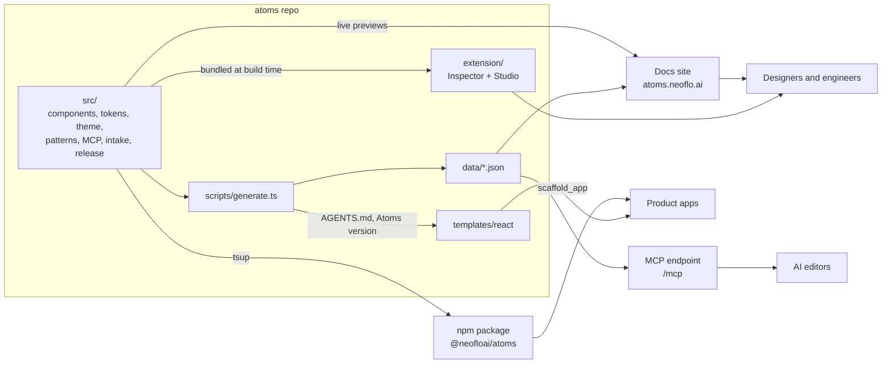

**Stack:** Next.js 16 (App Router), React 19, TypeScript 5 in strict mode, MUI 9 with MUI X (DataGrid, date pickers, free tier), Emotion, Phosphor icons, Day.js, and self-hosted DM Sans, DM Mono and Instrument Serif. The library is built with tsup and the MCP server with the official MCP SDK. Node 22 or later.

**Size today (v4.1.0):** 44 documented components (81 runtime exports once sub-parts like `CardHeader` and `MenuItem` are counted), 6 page patterns and 10 MCP tools, across 12 releases since June 2026.

---

## 2. The core idea: wrap MUI, don't rebuild it

Atoms does not draw its own components from scratch. Every component wraps a Material UI component. MUI already provides the parts that are expensive to get right: focus handling, keyboard behaviour, popover positioning, the data grid and the date pickers. Atoms adds two things on top: **Neoflo's look**, and **Neoflo's API**.

### Neoflo API on the outside, MUI API on the inside

People using Atoms never see MUI's vocabulary. They write the design team's words, and the wrapper translates:

| A product engineer writes | The wrapper passes to MUI |
| --- | --- |
| `variant="error"` (a colour role) | Nothing: MUI's `color` is not used, and the role is painted from tokens |
| `appearance="outline"` | `variant="outlined"` |
| `size="sm"` / `md` / `lg` / `xl` | `size="small"` / `medium` / `large` / `large` |

All other props pass straight through, including `onClick`, `disabled`, `loading` and `startIcon`. In the type definitions this is literal: `ButtonProps` is MUI's props with `variant`, `size` and `color` removed (`Omit`) and Neoflo's versions added.

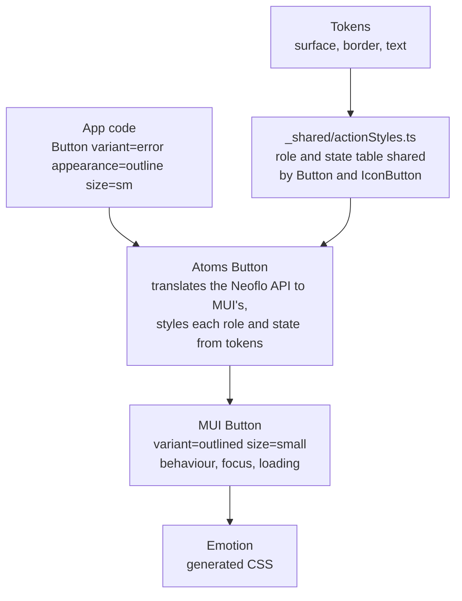

### Rename, never reinvent

The rule is **mirror MUI**. Atoms renames props and applies tokens, but it does not invent new abstractions. If MUI builds something by composing two components, Atoms composes the same two internally rather than adding a bespoke prop. For example, MUI builds an avatar's status dot from `Avatar` inside a `Badge`, so Atoms does too. A team that knows MUI can read any Atoms component, and MUI upgrades stay mechanical.

Sometimes a Figma design asks for something MUI cannot do. In that case Atoms uses the closest MUI primitive and **records the gap** in [`DESIGNER_QUESTIONS.md`](DESIGNER_QUESTIONS.md), which has 76 entries so far. Nobody quietly builds a one-off. The log is internal: it is never linked from the public docs or from anything that ships in the package.

### The deliberate exceptions

Some components are re-exported from MUI unwrapped. The test is whether a designer could redline it:

- **Layout primitives:** `Box`, `Stack`, `Grid`, `Container`. These render a bare element with no colour, type or border of their own, so there is nothing to brand. Their `sx` prop already resolves against the Atoms theme. Wrapping them would also *remove* capability: MUI's polymorphic typing (`component="a"` makes `href` type-check) collapses when the component is re-declared through `forwardRef`.
- **Motion:** `Fade`, `Grow`, `Slide`, `Zoom`, `Collapse`. A transition renders no DOM and takes its timing from the theme, so a wrapper with fixed timings would be less themed, not more.
- **`CardMedia`, `InputAdornment`, and the `useColorScheme` hook:** each has nothing to brand.

The opposite case matters as much. **`Typography` is wrapped even though the theme styles most of its variants.** MUI variants such as `subtitle1` and `overline` are not mapped to the Atoms type scale and silently fall back to Material's metrics. The wrapper narrows `variant` to the sizes the scale actually defines. Some components also add the half that MUI leaves to each app. `Snackbar`, for example, ships with a `SnackbarProvider` queue and a `useSnackbar` hook, so two toasts never cover each other.

---

## 3. Design tokens

Every visual value (colour, spacing, radius, type, shadow) comes from `src/tokens/`. No component or app writes a hex code or a pixel value that a token already covers.

### The layers

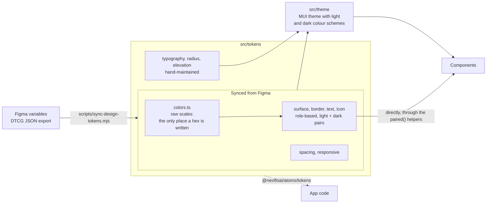

1. **Raw scales** (`colors.ts`): each hue (`grey`, `primary`, `blue`, `red` and so on) mapped to a hex per step. This is the only file that contains hex values.
2. **Semantic tokens** (`surface`, `border`, `text`, `icon`): named by role, never by colour. **Every one is a `{ light, dark }` pair**, which is how dark mode works without any per-component code.
3. **The MUI theme** (`src/theme/`): maps tokens onto MUI's palette, typography, shadows and shape. It uses MUI's CSS-variables mode, so switching between light and dark only changes an attribute on the page.

### Details worth knowing

- **Tokens are synced from Figma, not typed in.** The designer exports Figma variables as DTCG JSON, `sync-design-tokens.mjs` regenerates the TypeScript, and nobody hand-edits the generated files. Figma's variables don't cover typography, radius or elevation, so those three are maintained by hand.
- **Text and icon tokens use the designer's exact names.** When a designer says `text/default/b2`, the code says `text.default.b2`, with no translation table. v2.0.0 renamed every text and icon token to make this true. It was a breaking change, made because a translation table produces wrong-rung bugs that look intentional.
- **Figma quirks are copied as-is.** If an export looks like a slip, the value is carried through verbatim and the question is logged, rather than "fixed" in code. Fixing it in code would put a brand decision there that no designer made.
- **Motion is MUI's default on purpose.** The design system specifies no durations or curves, and inventing them would again be a brand decision without a designer behind it.
- **`NeofloThemeProvider`** is the one wrapper an app mounts. It applies the theme, `CssBaseline`, Day.js date localisation (so `DatePicker` works with no setup) and default icon sizing. It works the same in Vite, Next or anything else, because it deliberately leaves server-side style caching to the host app.

---

## 4. Anatomy of a component

Every component is a folder with the same four files:

| File | What it holds | Who reads it |
| --- | --- | --- |
| `Button.tsx` | The wrapper: Neoflo-to-MUI translation, token styling, a long *why* comment | The package build |
| `Button.types.ts` | Exported prop types, each documented | Editors (hover hints), the package's `.d.ts` |
| `Button.examples.tsx` | Tagline, prop docs, examples, do's and don'ts, related components | The docs site **and** the MCP server, via the generator |
| `index.ts` | Re-exports | `src/index.ts`, the public barrel |

Styling that is shared across components lives in `src/components/_shared/`. For example, `actionStyles.ts` holds the role and state table that both `Button` and `IconButton` read. Where the two Figma component sets disagree on a value, the table records which control each value belongs to.

### The comments are part of the design

Source files carry long comments explaining **why** each value is what it is: which Figma redraw it came from, where the design disagreed with itself, and what was decided. For example, the button's height and padding logic explains why a Figma stroke drawn *inside* a frame has to be subtracted from CSS padding. This is deliberate. A design system accumulates many small decisions, and a decision with no recorded reason gets reverted by the next person to touch it.

### Every colour names its token

Components apply mode-aware colours through three helpers (`paired`, `pairedFocusRing`, `focusRing`). In a **development** build these also write a CSS custom property next to each value:

```css
background-color: #4949dc;
--atoms-background-color: "surface.primary.default";
```

The browser ignores these properties. The Atoms Inspector reads them to name the exact token behind a colour and to spot when something else overrode it (see [section 11](#11-atoms-inspector-and-atoms-studio)). Production builds strip them out completely, and a build check proves it.

### Adding a component

1. Check whether MUI already has it. If it does, wrap it.
2. Create the folder with its four files, translating to MUI's API and styling from tokens.
3. Export it from `src/index.ts`. The MCP server only knows about what the barrel exports.
4. Add a docs page at `app/(docs)/components/<slug>/`.
5. Run `npm run generate`, then check it in the browser.

---

## 5. One source, many readers: the generator

The docs site, the MCP server and the extension all need the same facts about components, tokens and patterns. Rather than each of them parsing the source, **one script** (`scripts/generate.ts`) reads `src/` and writes plain JSON to `data/`. Everything else reads that JSON.

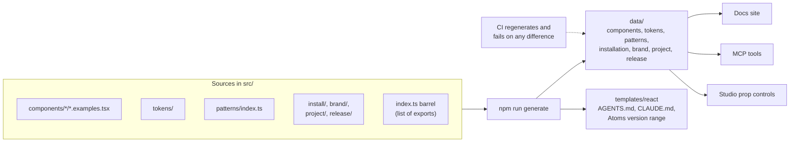

Some details:

- **`data/` is never edited by hand.** CI re-runs the generator and fails the pull request if the committed JSON differs, so the docs and the MCP server can't fall out of step with the code.
- **The generator is idempotent.** The `generatedAt` timestamp only changes when the content does, so re-running it produces no diff.
- **It refuses to run if the version is inconsistent.** `package.json`, `ATOMS_VERSION` in code, and the newest changelog entry must all agree. If they don't, it fails before anything builds (see [section 12](#12-versions-and-releases)).
- **Patterns are listed explicitly, not discovered.** A half-written pattern stays out of the docs and the MCP server until someone adds its line on purpose.

---

## 6. The npm package

### Four doors in, and only four

Apps import from exactly four paths:

| Import | What it gives |
| --- | --- |
| `@neofloai/atoms` | Components, `NeofloThemeProvider`, `useColorScheme`, `NeofloLogo`, `ATOMS_VERSION` |
| `@neofloai/atoms/icons` | The full Phosphor icon set, tree-shakeable |
| `@neofloai/atoms/tokens` | Raw and semantic tokens |
| `@neofloai/atoms/theme` | The constructed MUI theme object |

Importing from `@mui/material` in an app *does* work, and that is exactly the danger: it bypasses the design system without any visible sign. The docs, the MCP server's instructions and a CI check on every code snippet we publish all steer people to these four paths.

### Installed from GitHub, not a registry

The repo is public, so apps install straight from GitHub, pinned to a semver range over the release tags. No registry account or token is needed:

```bash
npm install github:neofloai/atoms#semver:^4.1.0
```

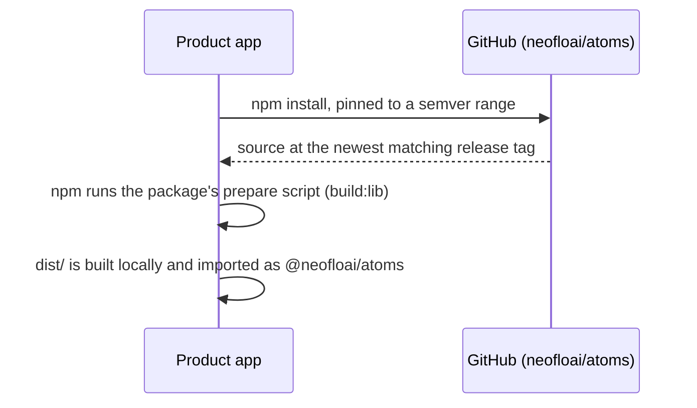

`dist/` is never committed. npm builds it on install through the `prepare` script, so an app always gets a build that matches the tagged source. This has two consequences. First, an app's build machine needs `git`, and must not run `npm ci --ignore-scripts`. Second, the string in an app's `package.json` is a git ref or a range, not a version. That second point is why the MCP server needs a version gate ([section 8](#8-the-mcp-endpoint-atoms-for-ai-editors)).

### How it builds

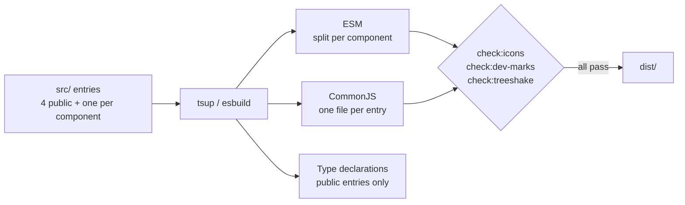

React, MUI, Emotion, Phosphor and the fonts are all `external`. The app's bundler provides them, so there is only ever one copy of each.

Three of the build's decisions were each learned from a real problem:

- **Per-component splitting (v4.1.0).** The library used to be one module. A bundler can't remove unused code past a top-level `styled()` call, so every app shipped every component, including DataGrid, the date pickers and Day.js. Now each component is its own chunk and an unused component is an unused file. The template's first load fell from **1.57 MB to 458 KB**. `check:treeshake` bundles an app that imports only `Button` and fails if any grid or picker code appears.
- **The icon leak (v1.0.1).** Re-exporting all icons with `export *` from an external package makes esbuild build a runtime object containing every icon. No bundler can prune that object, so an app that imported one button shipped **all 1,512 icons, about 5 MB**. Nobody could see it in review, because the published package itself stays small. The fix is `src/icons/glyphs.ts`, which names each of the 18 icons the components use. `check:icons` fails the build if the leak comes back.
- **Development marks stay out of production.** The inspector's CSS marks are gated on `process.env.NODE_ENV === 'development'`, written inline every time, because bundlers only fold that exact expression. `check:dev-marks` bundles the package as production and as development, and fails if the marks survive the first or are missing from the second.

---

## 7. The docs site

The docs site is a Next.js App Router application under `app/(docs)/`. Most pages are prerendered at build time.

- **Previews are the real components**, imported from `src/`, so a docs page cannot show something the package doesn't do.
- **Text comes from `data/*.json`**: taglines, props, examples, do's and don'ts. The MCP server serves the same object, so a person and an AI agent read the same guidance.
- **Search is built after each build.** Pagefind indexes the prerendered HTML, so a new page is searchable as soon as it exists, with nothing to register.
- Pages for components, tokens, icons, patterns, installation, "start a project", the MCP guide, branding, the changelog and help.

---

## 8. The MCP endpoint: Atoms for AI editors

This is the part of Atoms that makes it **AI-first**. An AI editor (Claude Code, Cursor) connects to `atoms.neoflo.ai/mcp` and can ask the design system directly what exists, how to use it and which values to apply, instead of guessing from training data.

| Tool | What it returns |
| --- | --- |
| `start_project` | The questions to ask before building; then, with the answers, a build plan |
| `scaffold_app` | Ordered commands to create a new app on the user's disk, with the brand wired in |
| `check_version` | Current release, changelog, and a verdict on a project's installed version |
| `list_components` | Everything, grouped, with the published patterns listed first |
| `get_component` | Props, examples, do's and don'ts, related components, patterns it appears in |
| `get_pattern` | A whole screen's reviewed code |
| `get_tokens` | Token values for a category |
| `get_installation` | Setup steps for Next.js or React |
| `search_docs` | Search across components, patterns, guidelines, brand and changelog |
| `build_from_json` | Turns an Inspector or Studio export into a React file built from Atoms |

**How it runs:** a Next.js route handler on the Node runtime, using the MCP Streamable HTTP transport in **stateless** mode. Every request gets a fresh server, so there is no session state to lose or pin to a machine. In production it requires a bearer token when `MCP_TOKEN` is set. It reads only `data/*.json`, never `src/`.

### The order of operations is sent when an editor connects

An AI agent only reads a tool's description once it is already considering that tool. That is too late for the mistakes that matter most. An agent that has already decided to write a dashboard from scratch never checks whether a dashboard pattern exists. So the server's `instructions`, the one text a client receives on connect before choosing any tool, carry the order of operations: gather the brief, scaffold in the right place, check the pattern, check each component, check the tokens, and import only from Atoms.

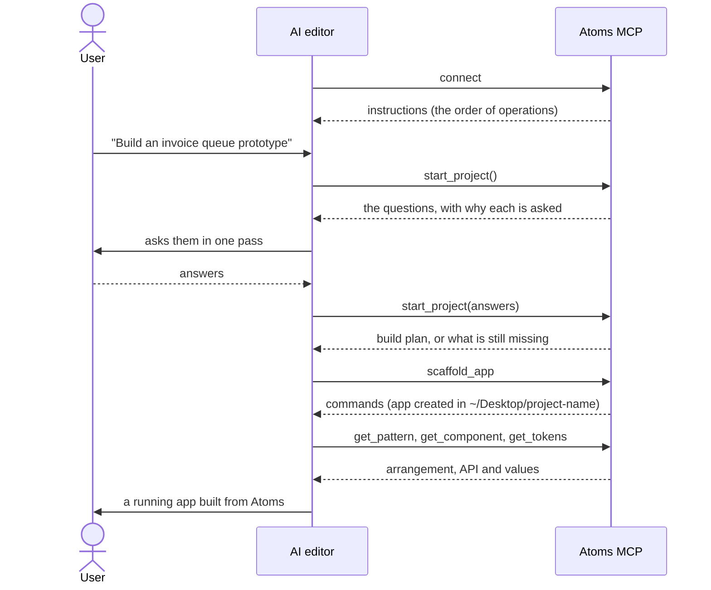

### The intake: ask before building

The most expensive mistakes in AI-built screens are not typos. They are **decisions made on the user's behalf**: a table built against invented columns, an app shell assembled the wrong way round, half the interactions wired with nobody having said which half mattered, or a project left in a folder the user can't find. Each one costs a rebuild, and each one is prevented by asking a question first.

`start_project` asks up to nine questions. Between three and six are required, depending on the answer to the first: **what are you creating?**

| Purpose | What gets built |
| --- | --- |
| Prototype | Always React + Vite, sample data, no backend, no stored state, so the demo resets cleanly |
| New project | React (recommended) or Next.js. Next only when something behind the UI needs a server |
| Existing project | Nothing is created. Atoms is installed into the app |

It asks about purpose, never about job title. The same three answers cover a designer, a manager and an engineer. A question is marked *required* only if a wrong guess costs a rebuild rather than an edit. New projects always go to `~/Desktop/<name>`, never into the agent's own working directory. The questions live in `src/project/`, and the docs page and the tool render the same objects, so they can't drift apart.

### The version gate: withhold code, never knowledge

The MCP server always serves the **current** release, but an app may be on any version. Because Atoms installs from a git ref, the app's `package.json` often doesn't even state a version. If an agent pastes code written for 4.1 into a 3.x app, the import fails, and the agent "fixes" its own mistake by inventing a plausible prop. The result is wrong in a way that looks intentional.

So `get_component` and `get_pattern` accept an `installedVersion`. The agent reads it with `npm ls`, not from `package.json`. The gate follows one rule: **it withholds pasteable code, never knowledge.** Props, rules and token values are always sent, because reading them can't break a build, and an agent refused everything stops asking and starts guessing. Code blocks are what get held back, because a code block is an instruction to paste.

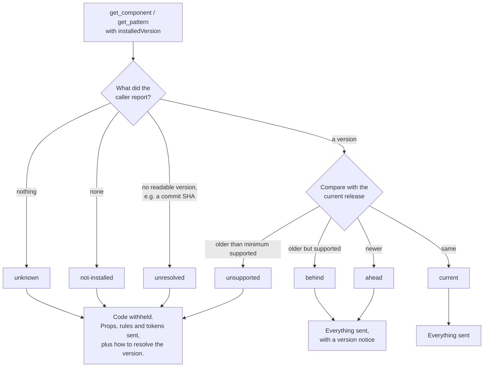

Three of the four blocking states mean *we don't know*, not *too old*. For a git-installed package, not knowing is the common case.

### `build_from_json`: translate, never restyle

This tool turns a screen captured by the Inspector or Studio into React code. It passes components the props the design gave them. Anything that **restyled** a component (an `sx` override, an inline `style`, a Studio override) is left out of the code and listed as a numbered gap, never copied into the code. Event handlers become no-ops listed under "Wire up". Copying a restyle would make a one-off look sanctioned. Listing it makes the design gap visible so it can be decided.

---

## 9. Patterns: whole screens, not components

A pattern is a **reviewed arrangement of components that makes a whole screen**. Component docs can't teach arrangement: which way round the rail and the app bar go, where the toolbar sits, how a table's bands stack. A screen assembled from individual component docs gets the arrangement wrong in ways no single component doc can warn about.

- **A pattern ships as code, not as a runtime export.** Its deliverable is the code that `get_pattern` returns and the docs page shows. A team copies it and owns it.
- **Patterns use components unmodified.** They never use an `sx` that reaches into a component to restyle it. When a frame wants something the library can't do yet, the pattern renders the stock component and records the gap against the component. A fix applied separately in eleven screens is how a design system stops being one.
- **No hand-drawn charts.** Atoms has no chart primitive. Where a design has a chart, the pattern recommends Recharts, coloured from the icon tokens, rather than drawing one by hand.

Five of the six patterns follow the invoice processing workflow:

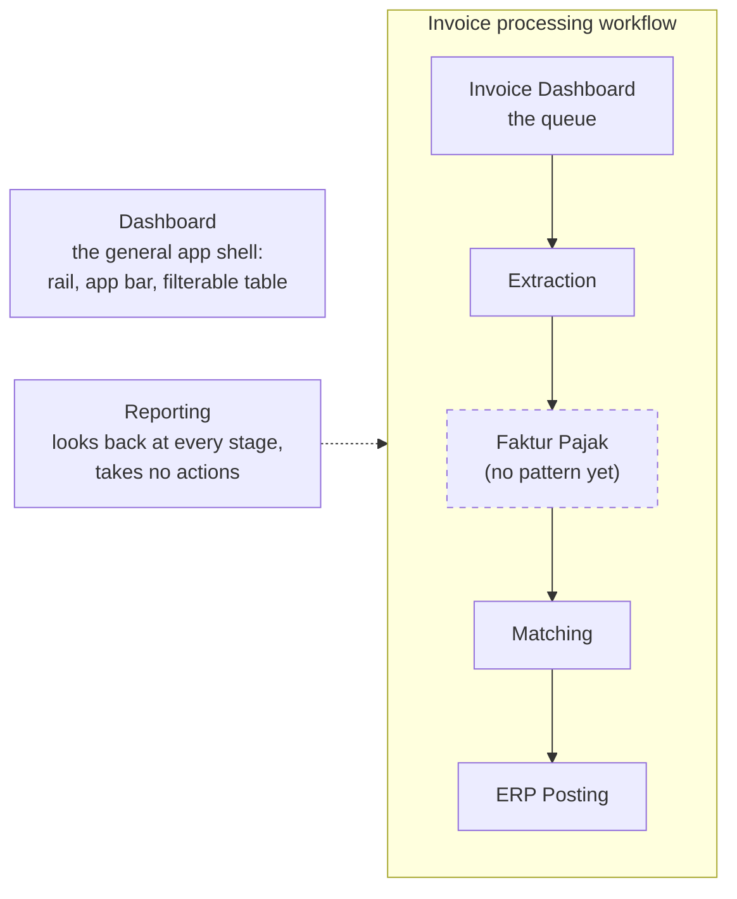

---

## 10. The React template

`templates/react/` is the app every new React project starts from. `scaffold_app` copies it at the current release tag (`npx giget@3 gh:neofloai/atoms/templates/react#v<version>`). It comes with Vite, strict TypeScript, React Router with lazy-loaded pages, TanStack Query, Vitest, oxlint, oxfmt and CI. `NeofloThemeProvider`, the favicons, the nav rail and an example `invoices` feature are already wired in.

The point is that **every Atoms app is laid out the same way**, so anyone who has worked in one can work in any of them. That includes an AI agent. The layout is four layers that only import downwards, and oxlint fails the build when a boundary is crossed:

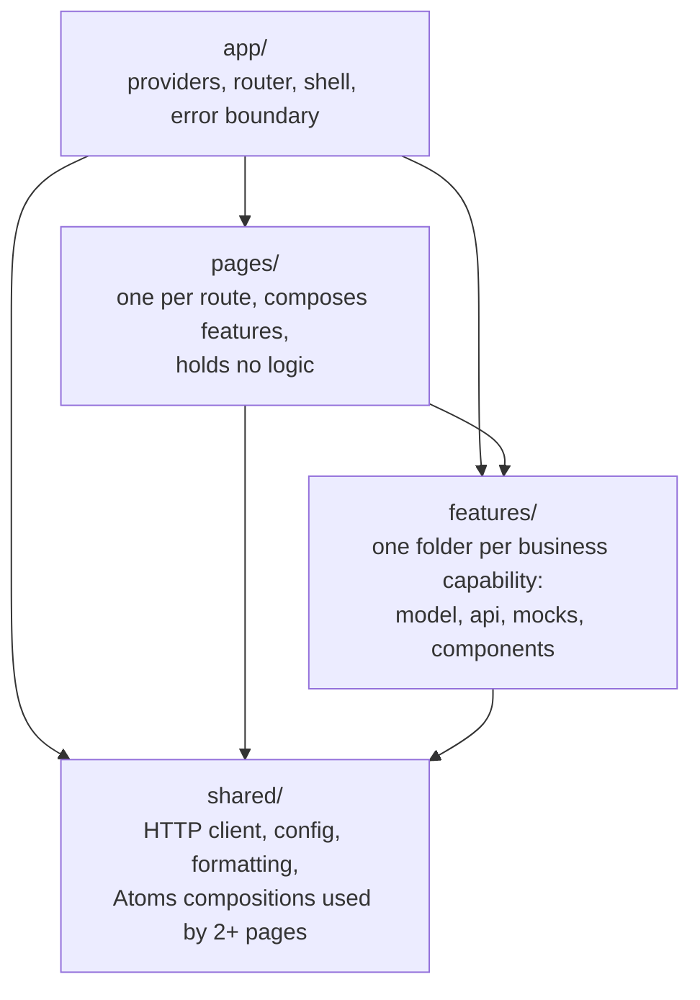

The template's `AGENTS.md` (which its `CLAUDE.md` imports) is **generated** from `src/project/structure.ts`. The rules an agent reads inside a scaffolded app are therefore the same rules `scaffold_app` and `start_project` serve, and the same ones on the docs site.

---

## 11. Atoms Inspector and Atoms Studio

`extension/` is a Chrome extension (Manifest V3, currently v0.8.9). It works like Figma's Dev Mode, but on a running app. It is a **consumer** of this repo: it reads the tokens and components at build time and is never part of the npm package. It is distributed as a zip and loaded unpacked.

- **Inspector:** hover any element to see the Atoms component, the props the caller wrote, the box model and distances, and the token behind every value. On a development build it reads the CSS marks from [section 4](#4-anatomy-of-a-component), so it can name a token exactly, even when two tokens share a hex. It can also flag **drift**: the component declared one token, something else rendered, and the note names the cause (`sx`, `style`, a global stylesheet, the wrong mode, a different Atoms version).
- **Export:** saves a screen, or one region of it, as `<name>.atoms.json` plus a screenshot.
- **Studio:** rebuilds an export with the real Atoms components in a full-page editor. Edits go through props and token pickers. Any change outside a component's props is stored as an override and always exported as a deviation, so Studio can't quietly create an off-system design.

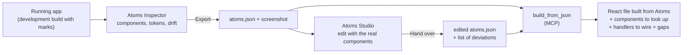

This closes the loop between design review and code. A designer can capture a live screen, adjust it within the system, and hand a developer a file that an AI agent turns into Atoms code, with every departure from the system listed rather than hidden.

---

## 12. Versions and releases

A release changes three things in one commit, and the generator fails the build if they disagree:

1. `version` in `package.json` (what npm installs)
2. `ATOMS_VERSION` in `src/release/version.ts` (what the package reports about itself at runtime, and exports)
3. A new entry at the top of `src/release/changelog.ts` (what the MCP tools compare an app against)

Then the release is tagged `v<version>`. Without the tag, a `#semver:` install can't resolve it and the template can't be copied at it.

- **The changelog is hand-written, not generated from commits.** Most commits change docs, data or the MCP server and are invisible to someone who installed the package. Each change carries a `scope` naming what moved, which is how `check_version` tells an app which of the things it uses changed since its install.
- **`minimumSupported`** is the oldest version the served code still runs on. It moves only when a release removes or renames something that code uses.
- **The extension ships separately.** It gets its own version bump and re-pack after a release, so the Inspector knows the new tokens.

| Version | Headline |
| --- | --- |
| 1.0.0 | First release: component library, tokens, patterns, MCP endpoint |
| 1.0.1 | Importing anything no longer pulls in the whole icon set |
| 2.0.0 | Text and icon tokens renamed to the exact Figma variable names |
| 2.1.0 | Table and tab bar redrawn; monospace font added |
| 2.2.0 | Development builds name the token behind every colour, for the Inspector |
| 3.0.0 | Button, form fields, chip, toggle group and Avatar follow the October redraw |
| 3.1.0 | Menu and MenuItem follow the navigation redraw |
| 3.2.0 | The app sidebar ships in the package |
| 3.3.0 | Sidebar resizes, collapses and animates |
| 4.0.0 | `Chip` becomes `Tag`; split button, password field, tab counts |
| 4.0.1 | Sidebar rail is 216px |
| 4.1.0 | React template and project rules; apps ship only the components they import |

---

## 13. CI, guard checks and hosting

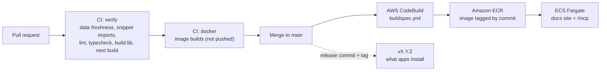

Each automated check exists because of a specific failure that a person reviewing a diff could not see:

| Check | Fails when | Why it exists |
| --- | --- | --- |
| Data freshness (CI) | `data/*.json` differs from a fresh generate | Docs and MCP must match the code |
| `check:imports` (CI) | A published snippet imports `@mui/material` | It happened: examples told readers to import from MUI while the install guide said not to, and a prototype did exactly that |
| `check:icons` | The icon namespace object reappears | The ~5 MB leak only shows up in a consumer's bundle |
| `check:treeshake` | Grid, picker or Day.js code survives in a Button-only app | Keeps the per-component split working |
| `check:dev-marks` | Inspector marks reach production, or vanish from development | Production stays clean; the Inspector keeps working |
| Version agreement (generate) | The three version sources disagree | Every tool downstream would state a version confidently, and one would be wrong |

**Hosting:** the docs site and MCP endpoint are one Next.js app in one Docker image, built with Next's standalone output and run as a non-root user. It can't be a static export because `/mcp` needs a live Node server. The MCP server reads `data/` from disk at request time, so the Dockerfile copies `data/` into the image explicitly. Deployment details and rollback steps are in [DEPLOYMENT.md](DEPLOYMENT.md).

---

## 14. How the repo is worked on

Atoms is built largely with AI coding assistants, so the rules those assistants follow are part of the architecture.

- **One rule set for both tools.** [`.cursor/rules/`](.cursor/rules/) is the single source of truth for Cursor and Claude Code. Cursor attaches each rule by file path. [`CLAUDE.md`](CLAUDE.md) imports the always-on rules and points to the path-specific ones. The rules cover MUI usage, tokens, component authoring, Next.js, docs, the MCP server, code style, project intake and the extension.
- **Rules carry reasons.** Like the source comments, each rule says *why*, so an assistant (or a person) can apply it to a case the rule didn't anticipate.
- **Design gaps are logged, not improvised.** Anything the design leaves ambiguous, or asks for that the library can't do, goes into `DESIGNER_QUESTIONS.md` for the designer to answer. Internal notes stay in the repo. Public docs describe behaviour on its own terms and never point at internal logs or Figma node IDs.

---

## 15. Trade-offs we have accepted

| Choice | What it costs | Why we accept it |
| --- | --- | --- |
| Built on MUI | Tied to MUI's major versions; Studio overrides depend on MUI's internal class names | MUI's behaviour, data grid and pickers would take far longer to build and maintain ourselves |
| Emotion (runtime CSS-in-JS) | Some runtime styling cost in every app | It is MUI's default engine, so everything MUI ships works with it unchanged |
| Install from GitHub | Apps need `git` at install; `dist` builds on install; the version is often unknown | No registry, no tokens, nothing to publish; the version gate covers the ambiguity |
| Theme provider includes Day.js | About 7.5 KB in every app, picker or not | `DatePicker` works anywhere with zero setup |
| Icons named one by one for components | One line per new glyph in `glyphs.ts` | The alternative shipped about 5 MB of icons to every app |
| No invented values | Motion is MUI's default; some designs wait on answers | Values in code with no designer behind them become permanent by accident |
| No chart primitive | Chart screens need Recharts alongside Atoms | A hand-drawn chart has no axes, tooltip, legend or empty state |

---

## 16. Repo map

| Path | What is there |
| --- | --- |
| `src/components/` | The wrapper components; `_shared/` holds internals shared between them |
| `src/tokens/` | Design tokens: the single source of every visual value |
| `src/theme/` | The MUI theme built from tokens, `NeofloThemeProvider`, `useColorScheme` |
| `src/icons/` | The icon subpath, and `glyphs.ts` (the icons the library uses itself) |
| `src/patterns/` | Whole-screen patterns, served as code |
| `src/mcp/` | MCP server, its ten tools, the version gate, `screen-code.ts` (`build_from_json`) |
| `src/project/` | The intake questions, scaffold targets and template structure |
| `src/release/` | Version, changelog and version checks |
| `src/install/`, `src/brand/` | Installation guides, logo and brand assets |
| `src/index.ts` | The public barrel; if it isn't exported here, it doesn't exist |
| `app/(docs)/` | The docs site |
| `app/mcp/route.ts` | The MCP HTTP endpoint |
| `scripts/` | The generator, token sync, search index, and the build checks |
| `data/` | Generated JSON; never edited by hand |
| `templates/react/` | The starter app `scaffold_app` copies |
| `extension/` | Atoms Inspector and Atoms Studio |
| `.cursor/rules/` | Working rules for AI assistants (and people) |
| `DEPLOYMENT.md` | Hosting, CI/CD, rollback |
| `DESIGNER_QUESTIONS.md` | Internal log of open design questions |
